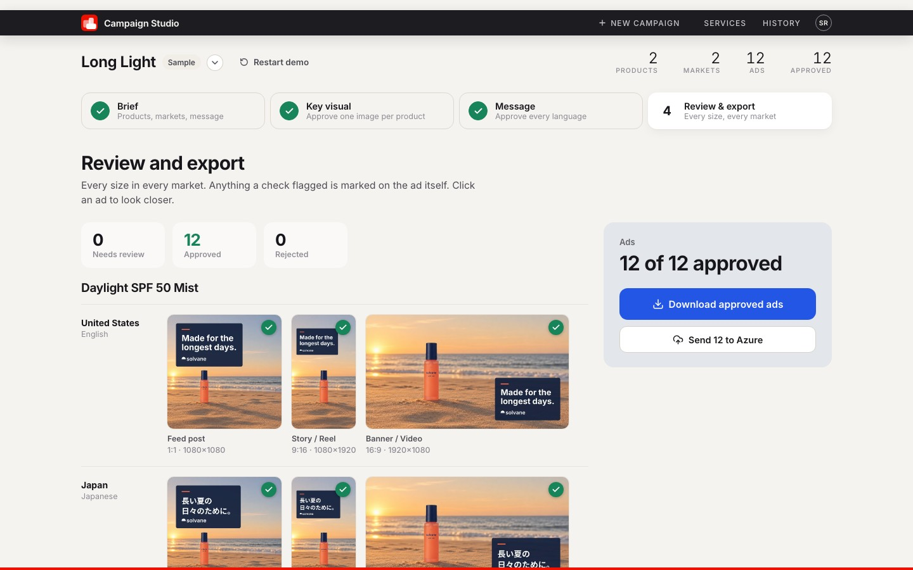
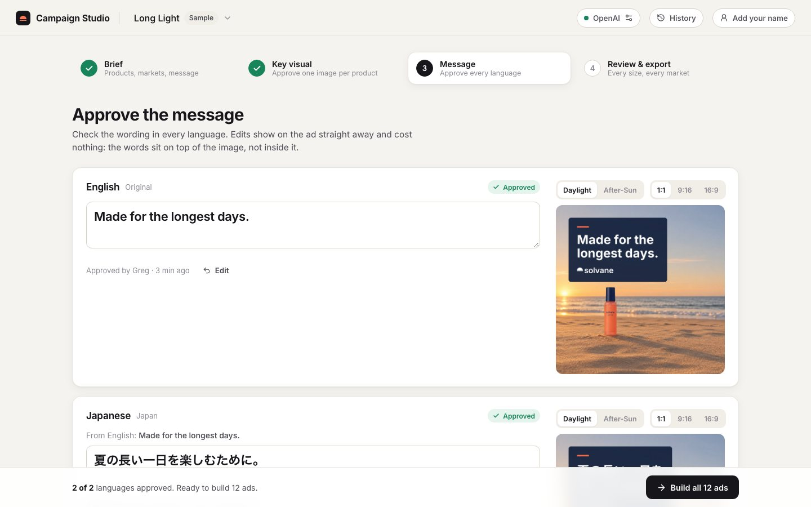
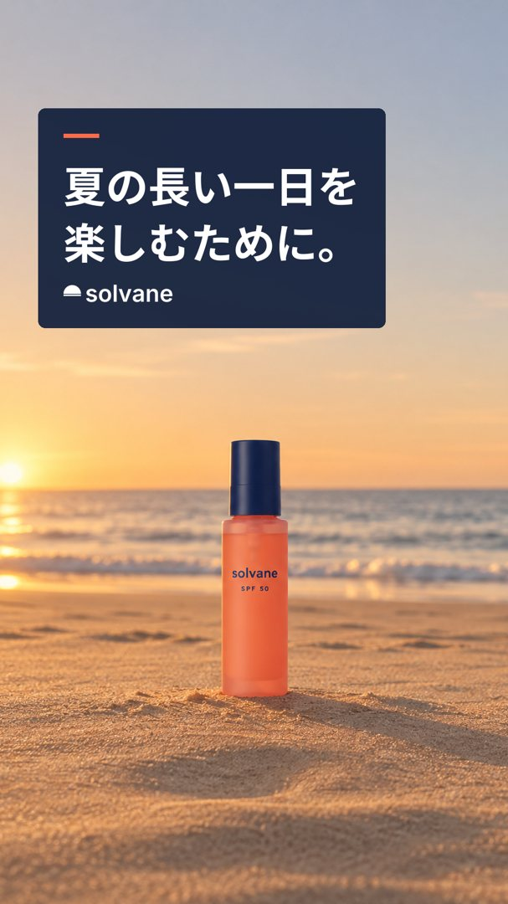

# Campaign Studio

**Turn one campaign brief into every social ad you need, in every size and every market. A person approves the key decisions; the system does the repetitive work.**



Campaign Studio is a proof of concept for a global consumer-goods brand that ships hundreds of localised social campaigns a month. You give it a brief: products, markets, audience, message. It then works the way a real creative team does:

1. **Brief.** Say what you're launching. Drop in product photos if you have them.
2. **Key visual.** The system makes one hero image per product (or uses your photo). You approve it, or ask for another.
3. **Message.** It adapts the line for each market. You check it and approve it, or edit it.
4. **Review and export.** It builds every size for every market, checks each ad against brand and legal rules, and marks any problem on the ad itself. You approve, then download.

Nothing is localised or resized until the key visual is approved, so a wrong image costs one generation, not a whole set.

## The assignment, ask by ask

| Requirement | Where it's met |
|---|---|
| A brief with two or more products, a market, an audience and a message | [`samples/long-light/brief.json`](samples/long-light/brief.json), edited on the **Brief** step. JSON (see *The brief format*). |
| Reuse input assets when they exist | Daylight SPF 50 Mist uses the supplied photo. Photos can also be dropped in on the Brief. |
| Generate missing assets with a GenAI image model | After-Sun Aloe Gel has no photo, so it's generated (OpenAI, or the [Firefly adapter](#adobe-firefly)). Free demo images with no key. |
| At least three aspect ratios | 1:1 feed post, 9:16 story, 16:9 banner. |
| The campaign message on the final posts, localized a plus | Set in real fonts on every ad, in English and Japanese. |
| Run locally | `python3 start.py` for the app, [`cli.py`](cli.py) for the same pipeline from the command line. |
| Outputs organized by product and aspect ratio | `outputs/<campaign>/<product>/<ratio>/` (see *What comes out*). |
| README: how to run, example input and output, design decisions, assumptions | *Up and running*, *What comes out*, *Key design decisions*, *Assumptions and limitations*. |
| Bonus: brand checks | Logo present and visible, brand colors used, on every ad (see *The checks*). |
| Bonus: legal checks | Restricted words per language, flagged as you type and blocking approval. |
| Bonus: logging and reporting | `report.json` per campaign, and **History** in the app. |
| Storage (Azure, AWS or Dropbox) | Every ad is saved locally; approved ads can also go to **Azure Blob Storage** with one click (see *Azure storage*). |

---

## Up and running in 2 minutes

You need **Python 3.9 or newer**. Macs already have it. On Windows, install it from [python.org](https://www.python.org/downloads/).

**1. Get the code**

On GitHub, click **Code → Download ZIP** and unzip it. (Or `git clone` it.)

**2. Start it**

In the unzipped folder, run:

```bash
python3 start.py
```

On Windows, `py start.py`. The first run takes about 30 seconds while it sets itself up, then your browser opens on a ready-made sample campaign. After that it starts instantly.

Keep that window open while you use the app; closing it stops the app. Your work is saved, and you can pick up where you left off.

**No terminal?** Double-click **Start Campaign Studio** in the same folder instead: the `.command` file on a Mac, the `.bat` file on Windows. It does exactly the same thing.

> **The first time, your computer will warn you about the launcher**, because it isn't from an App Store or a signed installer. You only do this once:
> - **Mac:** it says Apple could not verify the file. Click **Done**, open **System Settings → Privacy & Security**, scroll down, and click **Open Anyway** next to "Start Campaign Studio". (If you used `git clone`, there's no warning.)
> - **Windows:** if it says **Windows protected your PC**, click **More info**, then **Run anyway**.

**3. Sign in**

Every approval is stamped with the person who's signed in, so the app asks you to sign in first. For the sample, a demo account is already filled in: just click **Sign in**. There are two:

| Email | Password | Who |
|---|---|---|
| `sam@solvane.example` | `longlight` | Sam Rivera, creative lead |
| `aiko@solvane.example` | `longlight` | Aiko Tanaka, Japanese reviewer |

To add real people (each gets their own password; only a salted hash is stored):

```bash
python3 tools/team.py add "Full Name" name@company.com "Role"
python3 tools/team.py list
python3 tools/team.py remove sam@solvane.example
```

In production, sign-in comes from the client's single sign-on (Adobe, Okta or Microsoft) instead.

**4. Try it**

Click **Create key visuals** and follow the steps. To try your own brief, click **New campaign** at the top: start a blank one, or duplicate the current one and change it. **Restart demo** puts the sample back to how it shipped. With no API key it runs in **Demo mode**: images are drawn locally, instantly and for free, so you can try the whole flow. When you want real images, click **Services** at the top, paste an OpenAI API key, and you're done. The key is checked and saved on your computer only.

> **If something goes wrong**, the window says what to do in plain words. The most common one: the Mac asks to install "command line developer tools" the first time Python is used. Say yes, then start it again.

**Windows, Mac or Linux.** On every push, a GitHub workflow ([`fresh-install.yml`](.github/workflows/fresh-install.yml)) installs and runs Campaign Studio from a fresh copy on Windows (Python 3.9 and 3.12), macOS and Linux, with no API key, including the double-click launcher. It walks the whole flow, checks the download, and saves a screenshot of the app as it renders on each machine. [`tools/screenshots.py`](tools/screenshots.py) retakes the screenshots below from the running app.

**Want it in its own window?** In Chrome or Edge, click the install icon in the address bar (or **⋮ → Install Campaign Studio**). You get an app window and a dock or taskbar icon. It still needs the Start Campaign Studio window running, the same as the browser tab.

---

## A walk through the four steps

| | |
|---|---|
|  | **Brief.** Campaign name, message, audience, markets and products, all on one page that saves as you type. The right-hand panel shows what you'll get (here, 2 products × 3 sizes × 2 markets = 12 ads), and the button stays locked until the brief is complete. Restricted words are flagged as you type. |
|  | **Key visual.** One image per product. Fit the **product box** around the product: every size is cropped around it, and the message is kept off it. Outlines show exactly where the Story and Banner crops land, and the previews on the right update as you move the box. Approve, or try another. |
|  | **Message.** One card per language, with every product's ad beside it. The translation is adapted for the market, not swapped word for word. **In English** shows what it says, and **Changed the meaning** flags a line whose meaning has shifted, so a reviewer who doesn't read Japanese can still sign off, or **Ask for a change**. The words sit on top of the image, so editing re-renders instantly and costs nothing. Every language puts the message card in the same place on each ad, so the markets stay consistent. |
|  | **Review and export.** Every ad, grouped by product and market. Problems are boxed and numbered on the ad itself. Click any ad for a close-up with the full check list and a one-click route to fix the cause. Approve one at a time (keys: **A**, **R**, **← →**) or **Approve all that pass**, then download a ZIP of the approved ads, or **Show folder** to open them on disk. |

---

## What comes out

Everything is saved in `outputs/<campaign>/`, organised by product, then size:

```
outputs/long-light/
├── daylight-mist/
│   ├── 1x1/   US-en.png  JP-ja.png      1080×1080  Feed post
│   ├── 9x16/  US-en.png  JP-ja.png      1080×1920  Story / Reel
│   └── 16x9/  US-en.png  JP-ja.png      1920×1080  Banner / Video
├── after-sun-gel/   (same structure)
└── report.json
```

`report.json` is the audit trail. It records which image generator and model made each key visual, which service translated each line, the exact prompt, the result of every check on every ad, and **who approved what, and when**.

**Example input:** [`samples/long-light/brief.json`](samples/long-light/brief.json)
**Example output** (OpenAI run):

| Feed post, US | Story, Japan | Banner, US |
|---|---|---|
|  |  |  |

…with its [`report.json`](docs/examples/report.json).

### The brief format

```jsonc
{
  "campaign": "Long Light",
  "brand": { "name": "Solvane", "logo": "assets/logo.png",
             "colors": { "primary": "#14213D", "accent": "#FF6B4A", "neutral": "#F4E9DA" },
             "voice": "Warm, calm, confident." },
  "message": "Made for the longest days.",          // campaign message, shown on every ad
  "audience": "Active adults 25 to 40 who ...",       // target audience
  "markets": [ { "region": "US", "name": "United States", "language": "en" },
               { "region": "JP", "name": "Japan",         "language": "ja" } ],
  "products": [                                        // at least two
    { "id": "daylight-mist", "name": "Daylight SPF 50 Mist",
      "description": "...", "photo": "assets/daylight-mist.png" },   // photo given: reused
    { "id": "after-sun-gel", "name": "After-Sun Aloe Gel",
      "description": "..." }                                          // no photo: generated
  ],
  "mood": "Golden-hour summer light ...",
  "banned_words": { "en": ["waterproof", "sunblock"], "ja": ["完全", "絶対"] }
}
```

## Azure storage

Every ad is always saved on this computer. Once a container is connected, **Send to Azure** on the Review step uploads the approved ads and `report.json` to the client's Azure Blob Storage, in the same folders: `<campaign>/<product>/<ratio>/<market>.png`. Sending again replaces the files, so it's safe to repeat.

**How to connect it.** In the Azure portal, open the storage account, then the container, then **Shared access tokens**. Tick **Create** and **Write**, set an end date, and copy the **Blob SAS URL**. In the app, open **Services**, then **Storage → Azure Blob Storage → Connect**, and paste it. The app checks the link, saves one small file (`campaign-studio-check.txt`) to prove it can write, and keeps the link in `.env` on this computer only.

**Why a SAS link.** It's how a client's IT team would hand over access: one container, write-only, until a set date. No account key or password is stored, and nobody can read or list the container through it. The link never goes back to the browser, into a log or into an error message.

**How it's tested.** [`studio/storage.py`](studio/storage.py) is written to Microsoft's Put Blob documentation. [`tools/fake_azure.py`](tools/fake_azure.py) is a stand-in that answers the way Azure documents, and [`tools/test_azure.py`](tools/test_azure.py) runs 23 offline tests on every push: the link checks, the folders and headers sent, and every failure (expired, read-only, wrong container, busy, unreachable) as a plain sentence. It has also been run against a real Azure storage account: on 19 November 2026 it uploaded a campaign's approved ads and `report.json` to a container in West US 3.

## Launching in a new market

**Add market** lists two kinds of market. **Ready to use** markets work straight away. Markets **new to the brand** (South Korea, China and Saudi Arabia in the sample) need a one-time setup, so instead of half-working they ask for it, in one click:

- **Email the request** opens the user's own mail app with the subject and a plain-English request already written. No setup needed.
- **Post to Slack** appears when IT has connected a channel (set `STUDIO_SLACK_WEBHOOK` to a Slack incoming-webhook URL). Otherwise it's **Copy for Slack, Teams or a ticket**.
- The market then shows as **Requested**, with who asked and when, so nobody asks twice.

The request covers what's involved: a typeface for the script (with a mirrored layout for right-to-left languages), a native reviewer, legal sign-off on claims and local rules, and any local assets. The creative team downloads nothing. In production, the same hook would open a Jira or ServiceNow ticket instead.

## The checks

Every ad is checked automatically. Each failure says where it is on the ad and how to fix it.

| Check | What it asks | How |
|---|---|---|
| Message is easy to read | Can people read it on a phone? | WCAG contrast of white text against the brightest 10% of what's behind it (4.5:1 to pass) |
| Message stays off the product | Is the copy covering what we're selling? | Overlap between the message card and the product box |
| Product is fully in frame | Did this size crop the product? | How much of the product box survives the crop |
| Logo is on the frame | Is the brand signed off, and visible? | Logo placed, plus its contrast |
| Brand colours are used | Does it feel on-brand? | Share of the frame within reach of the brand palette |
| No restricted words | Would legal object? | Per-language restricted list, also enforced before a translation can be approved |
| Message fits the format | Did a long translation get squeezed? | Line count and how far the type had to shrink |
| Image is sharp | Was the picture blown up too far? | Source pixels against output size |

An ad that **fails** a check can't be approved. A **warning** is the reviewer's call.

---

## Key design decisions

**Approve the key visual first, then adapt.** This is how real production works: a key visual is signed off, then versioned. It speaks to the brief's slow approval cycles: each person approves one thing at the moment it matters, rather than reviewing a pile of finished variants. It also controls cost: a rejected key visual costs one generation, not twelve.

**Words go on top of the image, never into it.** Image models garble text and can't be corrected afterwards. Here, copy is set in real fonts at the end, so a wording change re-renders in under a second and costs nothing. Translations can be edited by the person who knows the market. This answers the brief's goal of adapting messaging to local cultures.

**A product box, not a guess.** Every crop and every layout decision depends on where the product is. Automatic detection is unreliable on stylised product shots, so a person fits a box once per product, in seconds. Every size is then cropped around it, and the message card is placed wherever overlaps it least.

**Layout tries options and picks the best.** For each size the message card is tried at the bottom, top, left and right. It takes the position that keeps clear of the product, then prefers clean line breaks and full-size type. Japanese breaks at natural phrase boundaries, not mid-word. Stories keep text out of the strips that Instagram and TikTok cover with their own buttons.

**Images and translation are two swap points.** The workflow calls two small interfaces in `studio/providers/`: one makes images, one translates. They're chosen separately under Services because not every service does both: **Adobe Firefly** makes images and has no text translation, so a team can pair Firefly images with another service's translation. Demo, OpenAI and Firefly (see below) ship for images; Demo and OpenAI for translation. Nothing the creative team sees changes with the choice. There's no silent fallback: if the chosen service fails, the person sees why, in plain words.

**Built to be run by the client, not by engineers.** One command, one dependency (Pillow), and the interface comes pre-built, so there's no Node or npm for the reviewer. It runs locally on `127.0.0.1` only. Errors are written for a creative team ("OpenAI didn't accept the key. Check it under Services."), not as stack traces.

**Approvals belong to a signed-in person.** The server stamps every approval, rejection and edit with whoever is signed in; it ignores any name the browser sends. Sessions are random tokens in an HttpOnly, SameSite=Strict cookie, and passwords are stored as salted PBKDF2 hashes in `workspace/team.json`. It's a stand-in for the client's single sign-on, built so that the audit trail in `report.json` means something.

**The same pipeline drives the app and the command line.** For batch runs or automation:

```bash
python3 cli.py                           # sample campaign, best available generator
python3 cli.py long-light --provider mock
python3 cli.py path/to/brief.json --provider openai
python3 cli.py --images firefly --translation openai
```

Like `start.py`, these set up the app's private Python environment the first time, so plain `python3` works on a computer that has never run the app.

`--provider` sets images and translation together; `--images` and `--translation` set them one at a time.

The CLI records its approvals as `cli`, so the report never pretends a person reviewed those ads.

## Adobe Firefly

In production a brand like this would use **Adobe Firefly Services**: its models are trained on licensed content and offered for commercial use, which matters for a global consumer brand. Firefly is an enterprise API. The client licenses it from Adobe, and their admin creates API credentials in the Adobe Developer Console under the client's own organisation.

**There is a Firefly adapter, and it has not been run against a live Firefly account.** I don't have Firefly Services access. The adapter ([`studio/providers/firefly.py`](studio/providers/firefly.py)) is written to Adobe's published API as read on 18 November 2026, including the OpenAPI file their reference links to. The code, the Services panel and this README all say so, and nothing is labelled as made by Adobe Firefly unless it came from Adobe's servers.

**What it does.** It signs in with the organisation's client ID and secret, starts an image job (`POST /v3/images/generate-async`), waits for it, and downloads the picture. It asks for 2048×2048, a size Adobe documents for Image 3 and Image 4, and the app crops and resizes from there as it does for any generator. Each failure becomes one plain sentence: wrong credentials, no Firefly access, allowance used up, a content-policy refusal, a busy or broken service, a job that failed or took too long.

**How to connect it.** In the app, open **Services** at the top. Under **Connect Adobe Firefly**, paste the client ID and client secret from the Adobe Developer Console (your project → add the Firefly Services API → OAuth Server-to-Server). They're checked with Adobe's sign-in server, saved on this computer only, in `.env`, and Firefly becomes a choice under **Images**. Firefly is never chosen automatically; a person selects it.

**How the wiring is proven without access.** [`tools/fake_firefly.py`](tools/fake_firefly.py) is a small stand-in for Adobe's sign-in and Firefly servers. It answers in the shapes Adobe documents, records every request, and can be told to fail in a chosen way.

```bash
python3 tools/test_firefly.py     # 39 tests: every request, every error message, the retry rule, the safety checks
python3 tools/test_azure.py       # 23 tests: the Azure link checks, uploads and every failure message
python3 tools/smoke_test.py       # also runs those, then makes a whole campaign through the stand-in server
```

Both are offline and need no key, so they run on every push. This proves the adapter does what the documentation describes. It can't prove the documentation matches the live service; the first run with real credentials is the remaining test. To try it by hand, run `python3 tools/fake_firefly.py` and follow what it prints. Images made that way say TEST SERVER, and the app records them as `firefly-test`, never as Firefly.

**Next for Firefly.** This adapter covers image generation only. The natural next step is fitting ad sizes with Firefly itself: **Expand** to extend a key visual to 9:16 and 16:9 instead of cropping it, and **Remove Background** to place a supplied product photo into a generated scene. Firefly's `promptBiasingLocaleCode` could also lean imagery toward each market. Image 5 uses a different address and request shape and isn't supported yet.

## Assumptions and limitations

- **Cloud storage is Azure only, and sent by a person.** Approved ads go to Azure when someone clicks **Send to Azure**, not automatically. AWS S3 and Dropbox would sit beside `studio/storage.py` as other targets; they aren't built.
- **The Firefly adapter is untested against the live service** (see *Adobe Firefly*). Three details couldn't be confirmed from Adobe's documentation and are handled defensively: the allowed range for a seed (kept between 1 and 100,000, as in every documented example); how this endpoint reports a content-policy refusal (status 451, Adobe's policy error codes and a match on the message text are all treated as one); and the sign-in server's wording when a scope is refused. Image 5 and custom models aren't supported.
- **The product box starts as a guess.** Demo images report exactly where the product is. For OpenAI and Firefly images and supplied photos, the box starts at a sensible default (or the `photo_focal` and `photo_zone` given in the brief), and a person fits it in step 2.
- **Translations vary from run to run.** That's why a person approves each one, sees what it says in English, and can edit it.
- **Sign-in is local.** People are kept in `workspace/team.json` on the machine running the app. There are no roles yet: anyone signed in can approve anything. Production would use the client's single sign-on and give, say, only the Japanese reviewer the right to approve Japanese.
- **Restricted words are a simple list per language.** It's a stand-in for a real legal-review service, not a replacement.
- **Fonts:** Inter (Latin) and Noto Sans JP (Japanese) are bundled under the SIL Open Font Licence, so output is identical on any machine. Other scripts are added per market (see *Launching in a new market*).
- **Branding:** Adobe red is the app's single accent, used in the interface chrome only, never on or around the ads. No Adobe logos are used, so nothing implies Adobe made or endorses this proof of concept.
- **Ads are saved as lossless PNG,** about 1.6 to 2.4 MB each at full size. A JPEG at quality 85 is about 200 KB, with no visible difference at phone size. It's a small change in the save step; it isn't made here because the ad platforms compress what's uploaded anyway.
- **Demo images are illustrations,** drawn locally to make the flow free to try. The report labels them `mock`.
- **The sample's "client-supplied" product photo** (`samples/long-light/assets/daylight-mist.png`) was itself generated with OpenAI for this demo. Solvane is a fictional brand.
- **Performance insights** (CTR and conversions by variant, goal 5 in the brief) aren't covered. `report.json` gives each ad a stable identity, which is what a later analytics join would use.
- **Tested on:** macOS by hand with Python 3.9 (the version macOS ships) and 3.12, from a clean copy with and without an API key. Windows, macOS and Linux automatically through the fresh-install workflow.

---

## For developers

```
Start Campaign Studio double-click launchers (.command for Mac, .bat for Windows); they run start.py
start.py              one-command launcher: sets up .venv, starts the server, opens the browser
cli.py                the same pipeline without the UI
studio/
  pipeline.py         the workflow and its state (workspace/<id>/state.json), report.json
  imaging.py          crop around the product, choose a layout, set type, draw the card
  checks.py           the eight checks
  brief.py            brief validation in plain language
  providers/          mock.py, openai_provider.py, firefly.py: the image and translation swap points
  storage.py          Azure Blob Storage: send the approved ads to the client's container
  server.py           local JSON API + static UI (standard library only)
  auth.py             sign-in: team, hashed passwords, sessions
  fonts/              Inter, Noto Sans JP (OFL)
web/                  React + Vite interface; built output committed in web/dist
samples/long-light/   the sample brief, logo and product photo
samples/team.json     the demo people, copied to workspace/team.json on first run
tools/team.py         add, list or remove the people who can sign in
tools/fake_firefly.py a stand-in for Adobe's servers, for testing Firefly with no account
tools/test_firefly.py the Firefly adapter's tests (offline)
tools/fake_azure.py   a stand-in for Azure Blob Storage; tools/test_azure.py, its tests (offline)
tools/                smoke_test.py (fresh-install test used by CI), screenshots.py (retakes the README screenshots), sample-asset scripts, a contact-sheet helper
.github/workflows/    fresh-install.yml: the fresh-install test (Windows, macOS and Linux)
```

**Changing the interface** needs Node 18 or newer:

```bash
python3 start.py
```

Then, in a second terminal:

```bash
cd web
npm install
npm run dev
```

Open `localhost:5173`, which forwards API calls to the running app. Run `npm run build` to update `web/dist`, the version everyone else gets.

**Settings** (optional, in `.env`): `OPENAI_API_KEY`, `STUDIO_SLACK_WEBHOOK` (where new-market requests post), `STUDIO_IMAGE_MODEL` (default `gpt-image-2.6-flare`), `STUDIO_TEXT_MODEL` (default `gpt-6-luna`) and `STUDIO_PORT` (default `8765`; the next free port is used if it's taken). For Firefly: `FIREFLY_CLIENT_ID` and `FIREFLY_CLIENT_SECRET` (the Services panel saves these), `FIREFLY_MODEL_VERSION` (`image3`, `image4_standard` or `image4_ultra`; left out, Adobe picks) and `FIREFLY_SCOPES`. `FIREFLY_IMS_URL` and `FIREFLY_API_URL` are for tests only: setting either marks everything made as coming from a test server. For Azure: `AZURE_STORAGE_SAS_URL` (the Services panel saves it); `AZURE_TEST_HOST` points it at the stand-in, for tests only.

Licence: MIT (code). Fonts: SIL Open Font Licence 1.1 (see `studio/fonts/`).
