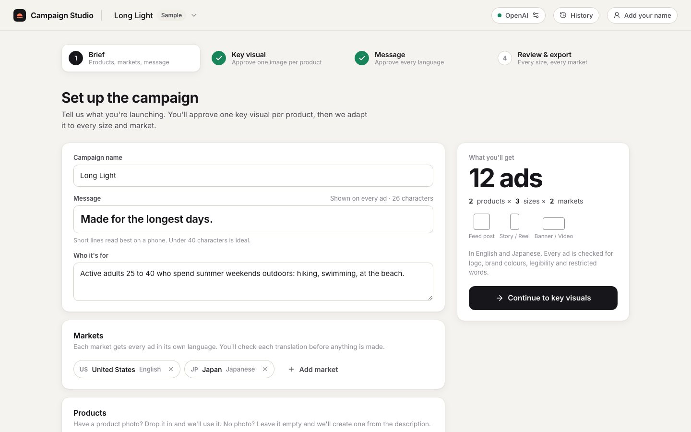
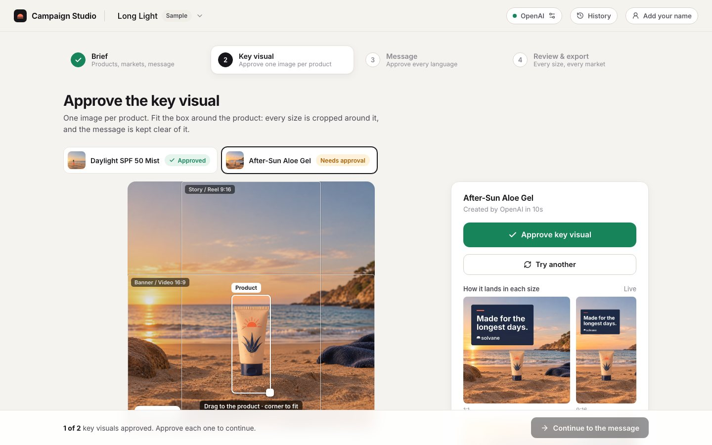
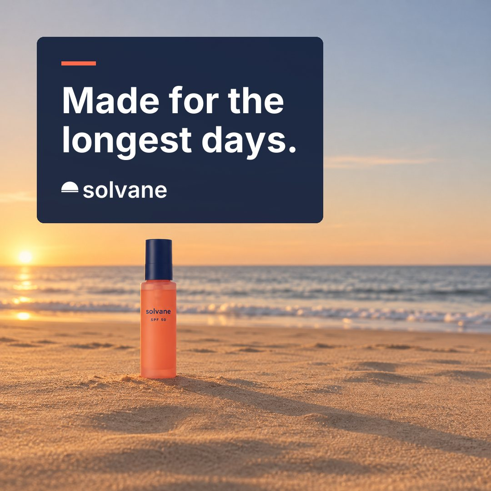
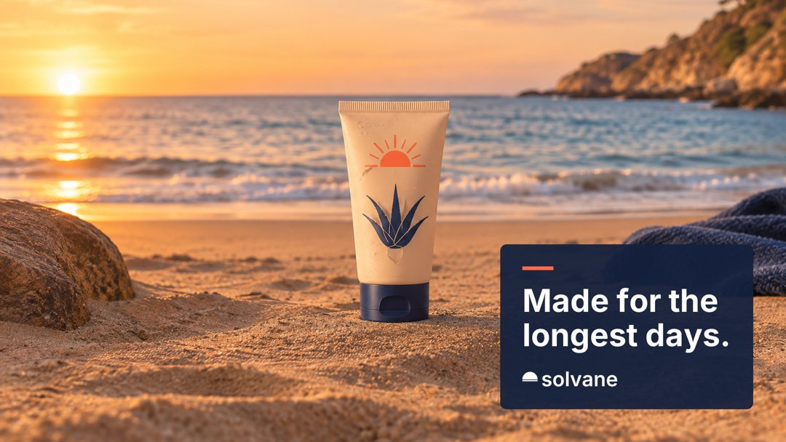

# Campaign Studio

**Turn one campaign brief into every social ad you need, in every size and every market. A person approves the key decisions; the system does the repetitive work.**


Campaign Studio is a proof of concept for a global consumer-goods brand that ships hundreds of localised social campaigns a month. You give it a brief: products, markets, audience, message. It then works the way a real creative team does:

1. **Brief.** Say what you're launching. Drop in product photos if you have them.
2. **Key visual.** The system makes one hero image per product (or uses your photo). You approve it, or ask for another.
3. **Message.** It adapts the line for each market. You check it and approve it, or edit it.
4. **Review and export.** It builds every size for every market, checks each ad against brand and legal rules, and marks any problem on the ad itself. You approve, then download.

Nothing is localised or resized until the key visual is approved, so a wrong image costs one generation, not a whole set.

---

## Up and running in 2 minutes

You need **Python 3.9 or newer**. Macs already have it. On Windows, install it from [python.org](https://www.python.org/downloads/).

**1. Get the code**

```bash
git clone <this repository's URL> campaign-studio
cd campaign-studio
```

(Or use **Code → Download ZIP** on GitHub, unzip it, and open a terminal in that folder.)

**2. Start it**

```bash
python3 start.py
```

On Windows, use `py start.py`.

The first run takes about 30 seconds while it sets itself up; after that it starts instantly. Your browser opens on a ready-made sample campaign. Press **Ctrl+C** in the terminal to stop it. Your work is saved, and you can pick up where you left off.

**3. Try it**

Click **Create key visuals** and follow the steps. With no API key it runs in **Demo mode**: images are drawn locally, instantly and for free, so you can try the whole flow. When you want real images, click the **Demo images** button at the top, paste an OpenAI API key, and you're done. The key is checked and saved on your computer only.

> **If something goes wrong**, the terminal says what to do in plain words. The most common one: the Mac asks to install "command line developer tools" the first time you type `python3`. Say yes, then run `python3 start.py` again.

---

## A walk through the four steps

| | |
|---|---|
|  | **Brief.** Campaign name, message, audience, markets and products, all on one page that saves as you type. The right-hand panel shows what you'll get (here, 2 products × 3 sizes × 2 markets = 12 ads), and the button stays locked until the brief is complete. Restricted words are flagged as you type. |
|  | **Key visual.** One image per product. Fit the **product box** around the product: every size is cropped around it, and the message is kept off it. Outlines show exactly where the Story and Banner crops land, and the previews on the right update as you move the box. Approve, or try another. |
|  | **Message.** The source line and each translation, side by side with a live ad preview. The translation is adapted for the market, not swapped word for word, and **What it says** shows its meaning in English so a reviewer who doesn't read Japanese can still sign off. Editing re-renders instantly and costs nothing: the words sit on top of the image, not inside it. |
|  | **Review and export.** Every ad, grouped by product and market. Problems are boxed and numbered on the ad itself. Click any ad for a close-up with the full check list and a one-click route to fix the cause. Approve one at a time (keys: **A**, **R**, **← →**) or **Approve all that pass**, then download a ZIP of the approved ads. |

---

## What comes out

Everything is saved in `outputs/<campaign>/`, organised by product, then size:

```
outputs/long-light/
├── daylight-mist/
│   ├── 1x1/   US-en.png  JP-ja.png      1080×1080  Feed post
│   ├── 9x16/  US-en.png  JP-ja.png      1080×1920  Story / Reel
│   └── 16x9/  US-en.png  JP-ja.png      1920×1080  Banner / Video
├── after-sun-gel/   (same structure)
└── report.json
```

`report.json` is the audit trail. It records which image generator and model made each key visual, the exact prompt, the result of every check on every ad, and **who approved what, and when**.

**Example input:** [`samples/long-light/brief.json`](samples/long-light/brief.json)
**Example output** (OpenAI run):

| Feed post, US | Story, Japan | Banner, US |
|---|---|---|
|  |  |  |

…with its [`report.json`](docs/examples/report.json).

### The brief format

```jsonc
{
  "campaign": "Long Light",
  "brand": { "name": "Solvane", "logo": "assets/logo.png",
             "colors": { "primary": "#14213D", "accent": "#FF6B4A", "neutral": "#F4E9DA" },
             "voice": "Warm, calm, confident." },
  "message": "Made for the longest days.",          // campaign message, shown on every ad
  "audience": "Active adults 25 to 40 who ...",       // target audience
  "markets": [ { "region": "US", "name": "United States", "language": "en" },
               { "region": "JP", "name": "Japan",         "language": "ja" } ],
  "products": [                                        // at least two
    { "id": "daylight-mist", "name": "Daylight SPF 50 Mist",
      "description": "...", "photo": "assets/daylight-mist.png" },   // photo given: reused
    { "id": "after-sun-gel", "name": "After-Sun Aloe Gel",
      "description": "..." }                                          // no photo: generated
  ],
  "mood": "Golden-hour summer light ...",
  "banned_words": { "en": ["waterproof", "sunblock"], "ja": ["完全", "絶対"] }
}
```

## The checks

Every ad is checked automatically. Each failure says where it is on the ad and how to fix it.

| Check | What it asks | How |
|---|---|---|
| Message is easy to read | Can people read it on a phone? | WCAG contrast of white text against the brightest 10% of what's behind it (4.5:1 to pass) |
| Message stays off the product | Is the copy covering what we're selling? | Overlap between the message card and the product box |
| Product is fully in frame | Did this size crop the product? | How much of the product box survives the crop |
| Logo is on the frame | Is the brand signed off, and visible? | Logo placed, plus its contrast |
| Brand colours are used | Does it feel on-brand? | Share of the frame within reach of the brand palette |
| No restricted words | Would legal object? | Per-language restricted list, also enforced before a translation can be approved |
| Message fits the format | Did a long translation get squeezed? | Line count and how far the type had to shrink |
| Image is sharp | Was the picture blown up too far? | Source pixels against output size |

An ad that **fails** a check can't be approved. A **warning** is the reviewer's call.

---

## Key design decisions

**Approve the key visual first, then adapt.** This is how real production works: a key visual is signed off, then versioned. It speaks to the brief's slow approval cycles: each person approves one thing at the moment it matters, rather than reviewing a pile of finished variants. It also controls cost: a rejected key visual costs one generation, not twelve.

**Words go on top of the image, never into it.** Image models garble text and can't be corrected afterwards. Here, copy is set in real fonts at the end, so a wording change re-renders in under a second and costs nothing. Translations can be edited by the person who knows the market. This answers the brief's goal of adapting messaging to local cultures.

**A product box, not a guess.** Every crop and every layout decision depends on where the product is. Automatic detection is unreliable on stylised product shots, so a person fits a box once per product, in seconds. Every size is then cropped around it, and the message card is placed wherever overlaps it least.

**Layout tries options and picks the best.** For each size the message card is tried at the bottom, top, left and right. It takes the position that keeps clear of the product, then prefers clean line breaks and full-size type. Japanese breaks at natural phrase boundaries, not mid-word. Stories keep text out of the strips that Instagram and TikTok cover with their own buttons.

**The image generator is a swap point.** The workflow calls one small interface (`studio/providers/`). Demo and OpenAI ship today. **Adobe Firefly** goes in the same place (see below), and nothing the creative team sees changes. There's no silent fallback: if the chosen generator fails, the person sees why, in plain words.

**Built to be run by the client, not by engineers.** One command, one dependency (Pillow), and the interface comes pre-built, so there's no Node or npm for the reviewer. It runs locally on `127.0.0.1` only. Errors are written for a creative team ("OpenAI didn't accept the key. Check it in Settings."), not as stack traces.

**The same pipeline drives the app and the command line.** For batch runs or automation:

```bash
python3 cli.py                           # sample campaign, best available generator
python3 cli.py long-light --provider mock
python3 cli.py path/to/brief.json --provider openai
```

The CLI records its approvals as `cli`, so the report never pretends a person reviewed those ads.

## Adobe Firefly

In production a brand like this would use **Adobe Firefly Services**: its models are trained on licensed content and offered for commercial use, which matters for a global consumer brand. Firefly is an enterprise API. The client licenses it from Adobe, and their admin creates API credentials in the Adobe Developer Console under the client's own organisation. Deployment then means connecting those credentials to the provider slot in `studio/providers/`.

This proof of concept doesn't include a Firefly adapter, because I don't have Firefly Services access to test one against. Shipping untested integration code didn't seem right. The settings panel shows Firefly as the option the client's Adobe team connects at setup.

## Assumptions and limitations

- **Storage is a local folder.** The brief mentions Azure, AWS or Dropbox. Outputs are written by one function (`Campaign.fan_out`) and served by another, so a cloud bucket is a contained change, but it isn't built.
- **The product box starts as a guess.** Demo images report exactly where the product is. For OpenAI images and supplied photos, the box starts at a sensible default (or the `photo_focal` and `photo_zone` given in the brief), and a person fits it in step 2.
- **Translations vary from run to run.** That's why a person approves each one, sees what it says in English, and can edit it.
- **Restricted words are a simple list per language.** It's a stand-in for a real legal-review service, not a replacement.
- **Fonts:** Inter (Latin) and Noto Sans JP (Japanese) are bundled under the SIL Open Font Licence, so output is identical on any machine. Korean and Chinese need their own Noto fonts added before those markets are offered.
- **Demo images are illustrations,** drawn locally to make the flow free to try. The report labels them `mock`.
- **The sample's "client-supplied" product photo** (`samples/long-light/assets/daylight-mist.png`) was itself generated with OpenAI for this demo. Solvane is a fictional brand.
- **Performance insights** (CTR and conversions by variant, goal 5 in the brief) aren't covered. `report.json` gives each ad a stable identity, which is what a later analytics join would use.
- **Tested on:** macOS with Python 3.9 (the version macOS ships) and Python 3.12, from a clean copy with and without an API key. Windows should work but hasn't been tested.

---

## For developers

```
start.py              one-command launcher: sets up .venv, starts the server, opens the browser
cli.py                the same pipeline without the UI
studio/
  pipeline.py         the workflow and its state (workspace/<id>/state.json), report.json
  imaging.py          crop around the product, choose a layout, set type, draw the card
  checks.py           the eight checks
  brief.py            brief validation in plain language
  providers/          mock.py, openai_provider.py: the generator swap point
  server.py           local JSON API + static UI (standard library only)
  fonts/              Inter, Noto Sans JP (OFL)
web/                  React + Vite interface; built output committed in web/dist
samples/long-light/   the sample brief, logo and product photo
tools/                scripts that made the sample assets, and a contact-sheet helper
```

**Changing the interface** needs Node 18 or newer:

```bash
python3 start.py
```

Then, in a second terminal:

```bash
cd web
npm install
npm run dev
```

Open `localhost:5173`, which forwards API calls to the running app. Run `npm run build` to update `web/dist`, the version everyone else gets.

**Settings** (optional, in `.env`): `OPENAI_API_KEY`, `STUDIO_IMAGE_MODEL` (default `gpt-image-2.6-flare`), `STUDIO_TEXT_MODEL` (default `gpt-6-luna`) and `STUDIO_PORT` (default `8765`; the next free port is used if it's taken).

Licence: MIT (code). Fonts: SIL Open Font Licence 1.1 (see `studio/fonts/`).
